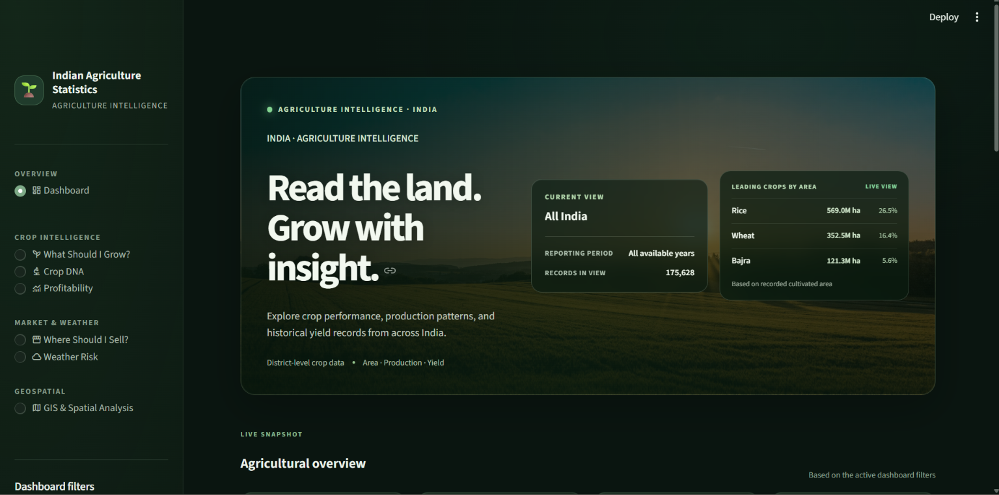
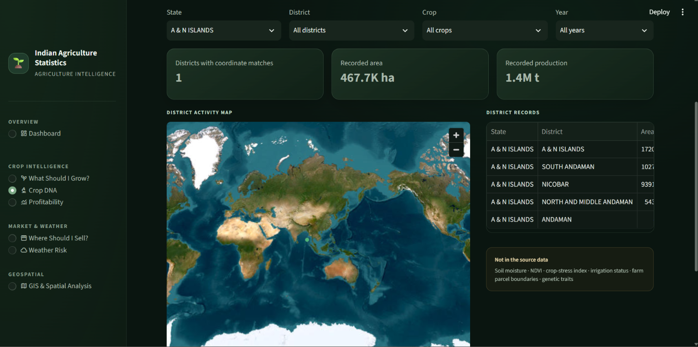
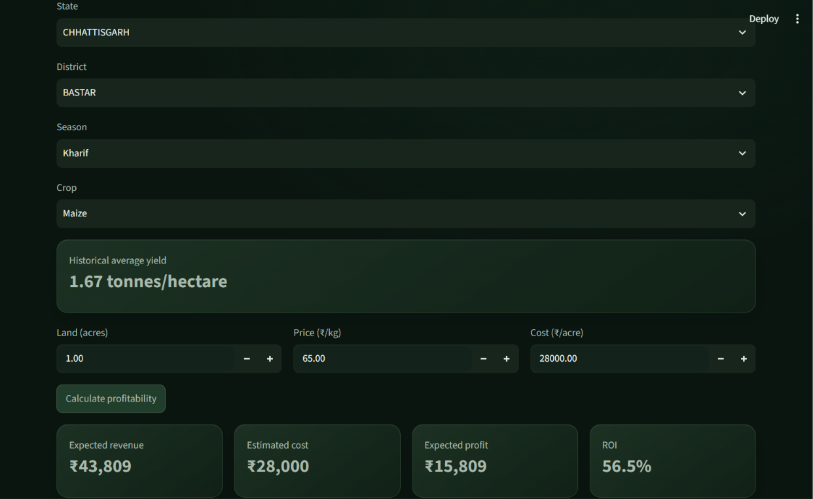
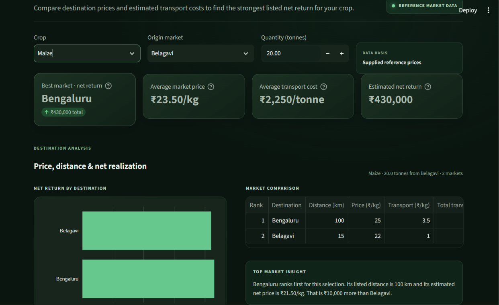
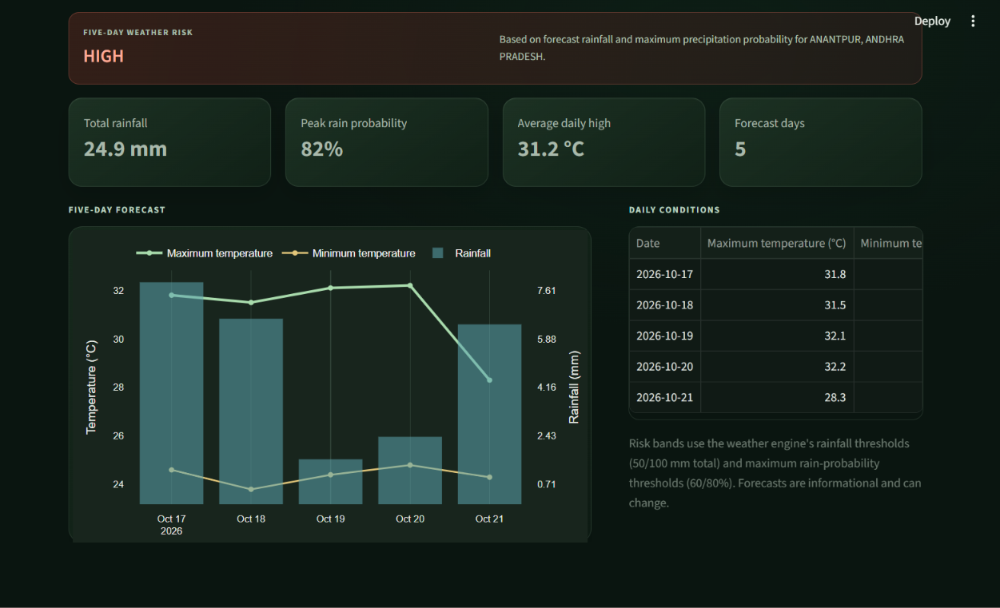
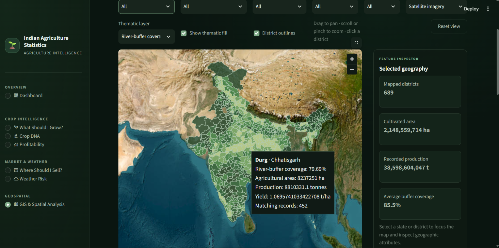

# 🌾 AgriProfit Intelligence

### Turning agricultural data into profitable decisions

AgriProfit Intelligence is an agriculture analytics platform that brings crop
production, historical yields, reference costs and prices, market comparisons,
and weather forecasts into one interactive application. It helps farmers,
analysts, and agri-businesses explore crop choices, estimate profitability, and
compare potential selling destinations.

> A high-yield crop is not automatically the most profitable crop. Better
> decisions consider yield, cost, price, location, season, and risk together.

---

## 🎯 The Problem

Agricultural information is often spread across separate datasets and tools.
Yield history alone cannot answer whether a crop is affordable to grow, what
its expected return might be, or whether a different market could improve the
sale price after transport.

The decision is not simply:

> "Which crop produced the most?"

It is:

> "Which available crop could offer a suitable return for this location,
> season, budget, and level of risk?"

## 💡 The Solution

The application combines the included agriculture statistics with supplied
crop-economics and market reference data, and can retrieve a five-day forecast
from Open-Meteo. Interactive tools turn these inputs into estimates and
comparisons, while making the assumptions and data coverage visible. A GIS
section also presents completed PostGIS river-buffer coverage results and
district-area comparisons when those result files are available.

## 🚀 Key Capabilities

### 1. Explore agricultural statistics

- Filter records by state, district, crop, season, and year.
- Review total area, total production, area-weighted average yield, and
  record-count summaries.
- Visualize crop area by state, production by crop, area trends, and state-by-crop
  area.

### 2. What Should I Grow?

Rank crops with historical district and season yields, land size, budget,
reference crop economics, and irrigation availability. Optionally include the
current five-day weather-risk category in the ranking.

### 3. Profitability

Estimate production, revenue, costs, profit, ROI, and price risk for a crop.
Land, sale price, and cost per acre are editable assumptions.

```text
Expected production = Historical yield × Land area
Expected revenue    = Expected production × Assumed selling price
Expected profit     = Expected revenue − Estimated cost
ROI                 = Expected profit ÷ Estimated cost × 100
```

The application converts acres to hectares and tonnes to kilograms when
combining the agriculture yield data with prices per kilogram.
The dashboard's average yield is area-weighted across records with valid
positive area and yield values.

### 4. Where Should I Sell?

Compare destinations listed in the supplied market data using price, distance,
estimated transport cost, and net realization for the selected quantity. The
comparison dashboard ranks the listed markets and summarizes their reference
prices and transport estimates; these are not live quotes.

### 5. Weather Risk

Look up a district using Open-Meteo geocoding, view its five-day forecast, and
summarize rainfall, maximum precipitation probability, and a simple risk
category. The view labels state-level coordinate fallbacks as approximate.

### 6. GIS & Spatial Analysis

- Explore district area covered by dissolved 5 km river buffers in a
  map-first workspace with district selection, state and district filters,
  satellite or dark basemaps, and thematic layers for buffer coverage,
  cultivated area, production, and area-weighted yield.
- Inspect selected geographies alongside agriculture records and river-buffer
  coverage, then review the ranked coverage chart and underlying results.
- The interactive outline map uses the districts in the supplied spatial
  export; it does not claim complete coverage of every current district.
- Review the initial comparison of calculated district areas with Census 2011
  reference areas.
- Results are generated with PostgreSQL/PostGIS and exported to CSV for the
  application. The GIS view is optional and does not require a live database
  connection when the result file is present.

### 7. Crop DNA

Explore historical crop-performance profiles by crop, state, season, and year,
including area-weighted yields, recorded area and production, and reference
economics where available. The field-monitoring view maps agriculture records
to district coordinates. It is not a genetic profile or live field-monitoring
system: the project does not include genomic traits, farm parcel boundaries,
NDVI, soil sensors, or irrigation observations, and the map does not infer
those values.

## 🧭 How the Application Works

```text
Agriculture CSV ──┐
Crop economics ───┼──> Pandas calculations ──> Estimates and rankings ──┐
Market reference ─┘                                                      ├──> Streamlit dashboard
District selection ──> Open-Meteo geocoding and forecast ────────────────┘
PostGIS analysis ──> CSV results ──> GIS & Spatial Analysis view
Agriculture history ──> Crop DNA profile and district-coordinate view
```

## 🛠 Technology Stack

- **Python** for application and analytics code
- **Pandas** for CSV data handling and calculations
- **Streamlit** for the interactive web application
- **Plotly** for interactive charts
- **Requests** for Open-Meteo API calls
- **PostgreSQL/PostGIS** for spatial queries, area calculations, and river-buffer
  analysis
- **GeoPandas** for loading and exporting spatial query results
- **CSV** for agriculture statistics and reference economics/market data

## ▶️ Run Locally

From the project root, install the dependencies and start the dashboard:

```bash
python -m pip install -r requirements.txt
streamlit run app/app.py
```

Open the local URL printed by Streamlit (usually
`http://localhost:8501`). The main agriculture dataset is read from
`Data/agridata.csv` or `data/agridata.csv`.

Weather lookup requires an internet connection. Crop recommendations and
profitability require `Data/crop_economics.csv`; market comparison requires
`Data/market_data.csv`. Crop DNA profiles can use the same crop-economics
reference file when it is available. Its district map uses
`Data/district_coordinates.csv` and historical agriculture records. The GIS &
Spatial Analysis view reads
`output/river_buffer_coverage_by_district.csv` and, when present,
`output/districts_intersecting_rivers.geojson` for the interactive boundary map.
To generate the optional GIS exports, configure the local PostGIS database and
tables documented in `sql/postgis/`, then run:

```bash
python 04_spatial_query.py
python 06_buffer_coverage.py
```

The GeoJSON and CSV exports are generated locally and are not included in the
repository. These GIS scripts are separate from the standard dashboard setup.

## 🗂 Project Structure

```text
Indian_Agri_Statistics/
├── app/
│   ├── app.py                       # Streamlit dashboard and tools
│   ├── recommendation_engine.py     # Crop yield, risk, and ranking logic
│   ├── profitability_engine.py     # Profit and ROI calculations
│   ├── market_engine.py             # Net market realization calculations
│   ├── weather_engine.py            # Geocoding, forecast, and weather risk
│   └── styles.css                   # Dashboard styling
├── Data/
│   ├── agridata.csv                 # Historical crop statistics
│   ├── crop_economics.csv           # Reference prices, costs, and risk inputs
│   ├── market_data.csv              # Reference destination prices and transport
│   ├── district_coordinates.csv     # District locations and state-level fallbacks
│   └── reference/
│       └── census_2011_district_areas.csv
├── docs/
│   ├── district_area_comparison.md  # GIS area comparison results and limitations
│   └── postgis/                     # CRS reprojection workflow
├── sql/
│   └── postgis/                     # PostGIS geometry and spatial analysis queries
├── src/                             # PostgreSQL-to-Pandas analysis pipeline
├── 03_geopandas_analysis.py
├── 04_spatial_query.py
├── 06_buffer_coverage.py
├── postgis_spatial_sql_interview_flashcards.ipynb
├── requirements.txt
└── Readme.md
```

The project also includes PostgreSQL-to-Pandas analysis code, census spreadsheet
inspection/conversion utilities, and additional standalone spatial validation
scripts. Raw GIS source data and generated output files are kept outside version
control.

## 🗄 PostgreSQL checks used for the agriculture dataset

The project includes PostgreSQL validation queries for the
`public.agriculture` table before indexing. These checks establish a baseline
for record volume, existing indexes, and the performance of common district and
crop-based queries.

```sql
-- Query 1: Count records
SELECT COUNT(*) AS total_records
FROM public.agriculture;

-- Query 2: Check existing indexes
SELECT indexname, indexdef
FROM pg_indexes
WHERE schemaname = 'public'
  AND tablename = 'agriculture'
ORDER BY indexname;

-- Query 3: District lookup performance
EXPLAIN (ANALYZE, BUFFERS)
SELECT
    state,
    district,
    crop,
    year,
    season,
    area,
    production,
    "yield"
FROM public.agriculture
WHERE state = 'PUNJAB'
  AND district = 'FIROZPUR';

-- Query 4: Rice yield analysis performance
EXPLAIN (ANALYZE, BUFFERS)
SELECT
    state,
    district,
    AVG("yield") AS average_rice_yield
FROM public.agriculture
WHERE LOWER(crop) = 'rice'
  AND "yield" IS NOT NULL
GROUP BY state, district
ORDER BY state, average_rice_yield DESC;
```

These SQL checks are intended as a baseline before adding indexes for common
filtering and aggregation patterns such as state, district, and crop analysis.

## 🗄 PostgreSQL indexing changes applied

The PostgreSQL optimization work adds targeted indexes for the most frequent
agriculture queries and then re-runs the same validation checks to confirm the
performance impact.

```sql
-- Index 1: Speed up state and district lookups
CREATE INDEX IF NOT EXISTS idx_agriculture_state_district
ON public.agriculture (state, district);

-- Index 2: Support crop-based analysis
CREATE INDEX IF NOT EXISTS idx_agriculture_crop_state_district
ON public.agriculture (LOWER(crop), state, district)
INCLUDE ("yield");

-- Update PostgreSQL table statistics
ANALYZE public.agriculture;

-- Verify indexes
SELECT indexname, indexdef
FROM pg_indexes
WHERE schemaname = 'public'
  AND tablename = 'agriculture'
ORDER BY indexname;
```

After indexing, the project re-checks the same district and rice yield queries to
compare execution plans and confirm the query improvements.

```sql
-- Check indexes
SELECT indexname, indexdef
FROM pg_indexes
WHERE schemaname = 'public'
  AND tablename = 'agriculture'
ORDER BY indexname;

-- District lookup after indexing
EXPLAIN (ANALYZE, BUFFERS)
SELECT
    state,
    district,
    crop,
    year,
    season,
    area,
    production,
    "yield"
FROM public.agriculture
WHERE state = 'PUNJAB'
  AND district = 'FIROZPUR';

-- Rice yield analysis after indexing
EXPLAIN (ANALYZE, BUFFERS)
SELECT
    state,
    district,
    AVG("yield") AS average_rice_yield
FROM public.agriculture
WHERE LOWER(crop) = 'rice'
  AND "yield" IS NOT NULL
GROUP BY state, district
ORDER BY state, average_rice_yield DESC;
```

This optimization focuses on faster filtering by state/district and crop-based
aggregation for agricultural analysis workflows in PostgreSQL.

## 🗺 PostGIS spatial analysis completed

The GIS work extends the agriculture data analysis with district geometry
validation, CRS reprojection, area measurement, and river-buffer overlays:

- Reprojected district geometries from EPSG:4326 to EPSG:7755 and created a
  separate EPSG:6933 equal-area layer. The workflows check feature counts,
  geometry validity, and spatial indexes.
- Compared spheroid-based `geography` areas with projected area calculations.
  Agreement between methods is reported only at the precision documented in the
  analysis; it does not validate the source geometries.
- Queried district intersections with dissolved 5 km river buffers and calculated
  the intersected area and percentage of each district.
- Produced 689 district coverage records. The mean buffer-covered area is
  85.47%; these are geometric overlap statistics, not measures of water access
  or agricultural impact.
- Compared calculated district areas with Census 2011 reference values. The
  initial comparison matched 550 districts, with a 206.71 km² average absolute
  difference and a 6.26% average percentage difference. The largest percentage
  difference was 603.44% for Lakshadweep; the cause remains unconfirmed.

The river coverage results used by the web app are exported to
`output/river_buffer_coverage_by_district.csv`. Generated CSV and GIS source
files are excluded from version control, so users need to run the PostGIS
workflow locally to regenerate them. SQL workflows are in `sql/postgis/`;
`docs/district_area_comparison.md` and `docs/postgis/reprojection_project.md`
describe methods and limitations. The notebook
`postgis_spatial_sql_interview_flashcards.ipynb` contains PostGIS practice
material.

## 📌 Data, Assumptions & Limitations

- The agriculture CSV contains state, district, crop, year, season, area,
  production, and yield fields. Check the source, coverage period, and units
  before using results for operational decisions.
- The included economics and market values are reference inputs, not guaranteed
  current prices or quotes. Market comparisons are limited to destinations and
  crops present in `Data/market_data.csv`.
- Weather uses local district representative points when available, then
  Open-Meteo geocoding. If neither resolves the district, the app uses a clearly
  labeled approximate state-level location; it is not a district forecast.
- `Data/district_coordinates.csv` stores representative points generated from the
  project's district boundary layer and state-level fallback points for its
  supported states.
- Profitability and recommendations are estimates based on historical average
  yield and the selected assumptions. They do not account for every factor
  affecting realized farm returns.
- Weather risk is a simple indicator based on five-day rainfall and precipitation
  probability thresholds; it is not an agronomic forecast or a substitute for
  local advice.
- Results depend on data quality, units, administrative boundaries, and the
  coverage of the available datasets. Confirm assumptions before making
  financial or planting decisions.
- District-area and river-buffer results depend on the source geometries,
  boundary vintage, CRS, and area method. The Census comparison is preliminary;
  large discrepancies have not been explained or corrected.
- Weather services may be unavailable or return no result for a selected
  location.

Document dataset publishers, source URLs, download dates, and applicable
licenses alongside future data updates.

## 🔬 Current Status

### Phase 1 — Analytics foundation

- [x] Python data processing and CSV ingestion
- [x] Agriculture data filtering and summaries
- [x] Pandas groupby, merge, and pivot analysis examples
- [x] Interactive agriculture visualizations
- [x] Streamlit dashboard

### Phase 2 — Decision tools

- [x] Crop profitability estimates
- [x] Crop ranking with yield, economics, budget, and irrigation inputs
- [x] Optional weather-risk input to crop ranking
- [x] Market destination comparison
- [x] Five-day weather risk view

### Phase 3 — Spatial analysis foundation

- [x] District geometry inspection, reprojection, and area calculation in PostGIS
- [x] Compare EPSG:7755, EPSG:6933, and spheroid-based area methods
- [x] Spatial intersection queries and 5 km river-buffer district coverage
- [x] Initial comparison of calculated district areas with Census 2011 references
- [x] Streamlit view for river-buffer coverage and area comparison summaries
- [x] PostGIS spatial SQL interview flashcards notebook

### Phase 4 — Potential next steps

- [ ] Resolve district-area discrepancies through source and boundary-vintage checks
- [ ] Automate documented ingestion from verified data sources
- [ ] Broader and regularly updated crop economics and market coverage
- [ ] Persistent data storage and service API
- [ ] User accounts and production deployment
- [ ] Validated forecasting models and decision support

## 📈 Future Vision

AgriProfit Intelligence aims to grow from an agricultural analytics dashboard
into a decision-support platform. The goal is to connect reliable data with
clear assumptions, helping users move from understanding what happened to
evaluating what may be a better next decision.

## 👨‍💻 Author

Built as a practical application of Python, data processing, analytics,
visualization, API integration, and business-oriented decision support.

### Dashboard screenshots







